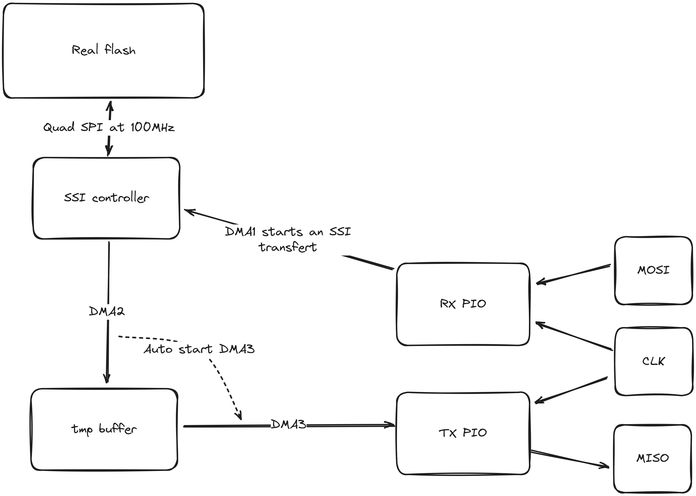

# SPI Flash emulator

This project is a RP2040/RP2350 program which emulates an SPI flash (specifically [Spansion FL032PIF](https://www.infineon.com/dgdl/Infineon-S25FL032P_32-Mbit_3.0_V_Flash_Memory-DataSheet-v13_00-EN.pdf?fileId=8ac78c8c7d0d8da4017d0ed4e2dd5369))

For now, the following commands are implemented:  
- Read (03h)
- Read fast (0Bh)
- Read Identification (9Fh)

Read commands works correctly at speeds up to 10 MHz, but the ID command only operates reliably up to 4 MHz.

The emulated flash size depends on the capacity of your external flash chip. The Raspberry Pi Pico includes a 4 MB flash, I reserve 1 MB for firmware, allowing for up to 3 MB of emulated flash.  
However, both the RP2040 and RP2350 support external flash sizes up to 16 MB. Some boards, such as the [Waveshare RP2040-Plus](https://www.waveshare.com/rp2040-plus.htm), come equipped with that flash capacity.

## Compile

Update `src/CmakeLists.txt` with the size of your real and emulated flash

### Using your environment 

Update `src/CmakeLists.txt` with the path of your PICO SDK

Update also the size of the emulated flash and the real flash, the linker script will place the emulated flash at the end.

```bash
cd src && mkdir build && cd build
cmake ..
make
```

### Using docker

You just have to run `./run.sh`

The compiled firmware will be in `src/build/flash_emulator.uf2`

## Usage

Put your data in `src/data.h` or you can create it dynamically using `src/gen_array.py`

Connect the pico to your spi master with the following pins:
- CIPO (MISO): GPIO 2
- Clock      : GPIO 3
- Chip Select: GPIO 4
- COPI (MOSI): GPIO 5

You can connect to usb serial to see received commands

## Developpement

### Architecture

This project uses PIO and DMA to send and receive data.



PIO flow for Read command:
- Both PIOs wait for CS to go low
- The read PIO reads the first byte and sends it to core1, which does the appropriate setup for the command while the address is being received
- The read PIO reads the address and sends it to it's FIFO which is connected to SSI data register. 
- The SSI controller will fetch requested data from flash using quad SPI at 100MHz which is fast enough to response data in time.
- When the transfert is finished, the DMA channel for PIO received is triggered. This DMA channel needs to be enabled after data has arrvied otherwire there is cache-related problems.

### Add a new chip

Most of the serial flash have the same command codes but in case it isn't, you can edit `src/sram.c`.  
The flash emulated here have a dummy byte between the request and the response, this dummy byte can be removed by patching the pio program `sram_write` in `src/sram.pio`

### Debug

In order to debug, [this folder](tester/) contains code to run master SPI on another pico. You can use this master to replicate your target device requests and/or do benchmark tests.

You just need to plug pins 2-5 on both PICOs.